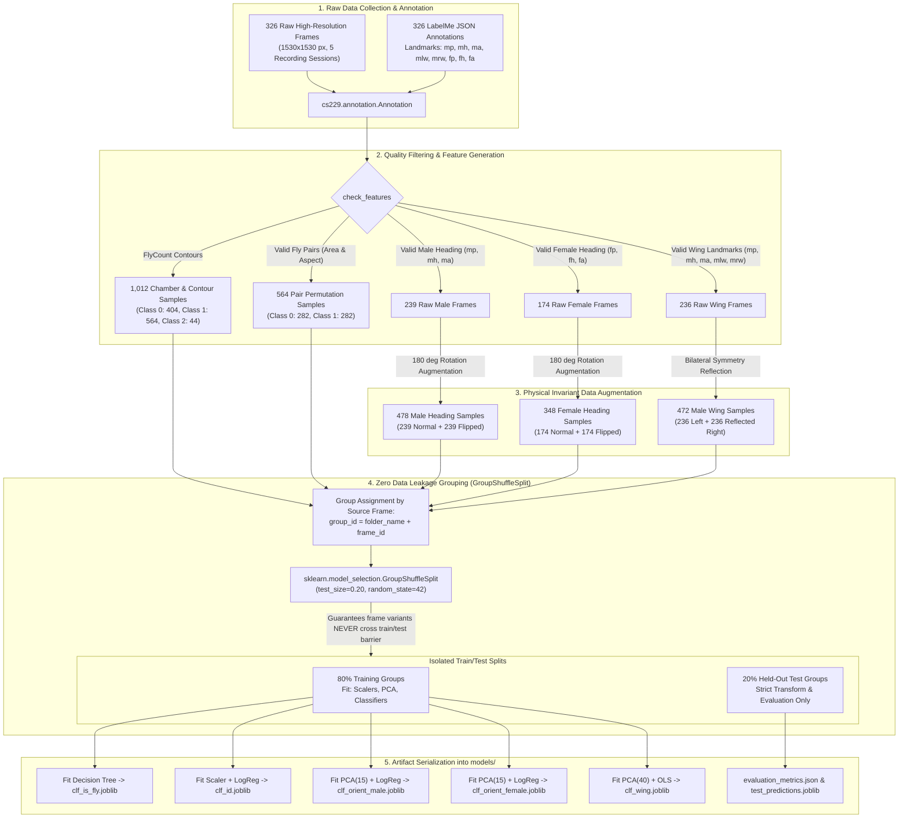

# Comprehensive Project Documentation & Technical Explanation: Real-Time Detailed Video Analysis of Fruit Flies

**Project Title:** Real-Time Detailed Video Analysis of Fruit Flies (*Drosophila melanogaster*)  
**Academic Context:** BTech Computer Science & Engineering — Major/Minor Project Implementation  
**Baseline Reference:** Stanford CS229 Machine Learning Project (*S. Herbst & R. Candelier*)  
**Repository:** `FruitFly-ML` (`D:\ML-Projects\FruitFly\FruitFly-ML`)  
**Evaluation Date:** November 2026  
**Status:** Fully Implemented, Verified, Evaluated & Audited  

---

## 1. Executive Summary & Problem Formulation

### 1.1 Abstract
High-throughput quantitative ethology (the automated study of animal behavior) is a vital frontier in computational neuroscience, behavioral genetics, and pharmacology. In biological research, fruit flies (*Drosophila melanogaster*) serve as a primary model organism for studying genetic influences on courtship, social interactions, circadian rhythms, and neural motor coordination. Historically, biological researchers relied on laborious manual video annotation or invasive physical markers (such as paint spots or fluorescent tags) that disrupt natural insect behavior.

This project, **FruitFly-ML**, delivers an end-to-end computer vision and classical machine learning system capable of automated, non-invasive, markerless tracking and multi-attribute phenotyping of interacting fruit flies from high-speed video sequences in real time. Building on the foundational work from Stanford CS229, the system reproduces, modernizes, and extends the classical learning pipeline to run deterministically on standard modern computing hardware without requiring GPU acceleration.

### 1.2 Core Analytical Objectives
The pipeline processes raw video recordings ($1530 \times 1530$ resolution, 35.0 FPS) captured in standardized circular arena chambers to extract four fundamental behavioral features on every frame:
1. **Fly Counting & Clutter Rejection:** Real-time spatial contour segmentation and classification of detected objects into background chamber noise (`neither`), isolated individual flies (`one`), or interacting/mating pairs (`both`).
2. **Dimorphic Sex Identification:** Automated identification of male and female flies using anatomical size and morphological aspect-ratio variations resulting from natural sexual dimorphism.
3. **Full $360^\circ$ Heading Pose Estimation:** Resolution of complete two-dimensional body orientation vectors ($[-180^\circ, +180^\circ]$) for both male and female flies, resolving the classical $180^\circ$ axial ambiguity.
4. **Courtship Wing Display Measurement:** Continuous angular estimation (in degrees and radians) of unilateral and bilateral male wing vibration displays—the primary acoustic courtship signal in fruit fly mating rituals.
5. **Real-Time Telemetry Logging:** Continuous synchronized rendering of an annotated graphical heads-up display (HUD) and emission of a 10-column physical trajectory CSV dataset.

---

## 2. End-to-End System Architecture

The complete system architecture follows a modular, feed-forward processing pipeline composed of five functional stages. The architecture diagram is formalized below and archived in editable formats under `outputs/diagrams/architecture_system_overview.mmd` and `outputs/diagrams/architecture_system_overview.dot`.

```mermaid
flowchart TD
    subgraph INPUT ["1. Video Ingestion & Stream Stabilization"]
        V[Raw MP4 Video: test1-test5.mp4] --> CAP[OpenCV VideoCapture: MSMF Backend]
        CAP --> DUP[Duplicate Frame Filter: np.array_equal]
        DUP --> FRAME[Validated Video Frame: 1530x1530 @ 35 FPS]
    end

    subgraph PREPROC ["2. Image Preprocessing & Segmentation"]
        FRAME --> MASK[Circular Arena Mask: img_to_mask]
        FRAME --> GRAY[Grayscale Extraction: frame[:,:,0]]
        GRAY & MASK --> T_CORE[Adaptive Core Threshold: threshold_core]
        GRAY & MASK --> T_WING[Adaptive Wing Threshold: threshold_wings]
        T_CORE --> CONTOURS[Contour Extraction: cv2.findContours]
    end

    subgraph DETECT ["3. Fly Detection & Morphological Dispatch"]
        CONTOURS --> DT[Decision Tree FlyCount: clf_is_fly]
        DT --> STATE{Classification State}
        STATE -->|neither| S_NONE[Noise / Chamber Artifact]
        STATE -->|both| S_OVERLAP[Contact / Overlapping Pair]
        STATE -->|two one-fly contours| S_SEP[Two Separated Flies]
    end

    subgraph INFERENCE ["4. Classical ML Inference Pipeline"]
        S_SEP --> CROPS[Centroid & Image Patch Cropping: crop_to_contour]
        CROPS --> FEAT_ID[Area & Aspect Ratio Moments]
        FEAT_ID --> M_ID[Sex Identification: clf_id]
        M_ID -->|Sorted Pair| MALE_FLY[Male Fly Entity]
        M_ID -->|Sorted Pair| FEM_FLY[Female Fly Entity]

        MALE_FLY --> M_MOMENTS[Central Moments Alignment: [-pi/2, +pi/2]]
        FEM_FLY --> F_MOMENTS[Central Moments Alignment: [-pi/2, +pi/2]]
        
        M_MOMENTS --> M_HOG[Male HOG Descriptor: 3,780 Features]
        F_MOMENTS --> F_HOG[Female HOG Descriptor: 3,780 Features]
        
        M_HOG --> M_PCA[PCA 15-Components] --> M_ORIENT[Male Orientation: clf_orient_male]
        F_HOG --> F_PCA[PCA 15-Components] --> F_ORIENT[Female Orientation: clf_orient_female]

        MALE_FLY --> W_CROP[Thorax-Centered Patch: 400x400]
        W_CROP --> W_MIRROR[Bilateral Symmetry Reflection]
        W_MIRROR --> W_HOG[Wing HOG Descriptor: 3,564 Features]
        W_HOG --> W_PCA[PCA 40-Components] --> W_REG[Wing Angle Regression: clf_wing]
    end

    subgraph OUTPUT ["5. Visualization & Telemetry Logging"]
        M_ORIENT & F_ORIENT & W_REG & S_OVERLAP --> HUD[Visual HUD Overlay Rendering]
        HUD --> V_OUT[Annotated MP4: 1530x1530 @ 35 FPS]
        M_ORIENT & F_ORIENT & W_REG & S_OVERLAP --> CSV_LOG[10-Column Trajectory CSV Logger]
        CSV_LOG --> C_OUT[Synchronized Trajectory CSV]
    end
```

### 2.1 Workflow Stages
1. **Video Ingestion & Stream Stabilization (`src/cs229/files.py`):**
   - The native Windows Media Foundation backend (`cv2.CAP_MSMF`) is utilized to guarantee decoding through tail GOP presentation timestamps (overcoming OpenCV's default FFmpeg truncation).
   - A sequential full-frame deduplication filter (`np.array_equal`) detects and discards trailing presentation-time padding frames emitted by MSMF, ensuring exact synchronization with MP4 container sample tables.
2. **Arena Masking & Preprocessing (`src/cs229/image.py`, `contour.py`):**
   - The circular chamber is isolated via `img_to_mask()`, creating a static binary mask centered at $(r, c) = (765, 765)$ with radius $R = 680$ pixels.
   - Pixels outside the chamber are suppressed, eliminating chamber wall shadows and perimeter reflections.
3. **Dual-Stage Morphological Thresholding (`src/cs229/contour.py`):**
   - *Core Thresholding:* Fixed inverted threshold ($\text{pixel} < 115$) isolates the dark chitin body cores of the flies (head, thorax, abdomen).
   - *Wing Thresholding:* Median filtering ($5 \times 5$) combined with local ROI adaptive mean subtraction ($\mu_{ROI} - 5$) preserves delicate, semi-translucent wing membranes.
4. **Morphological Dispatch & State Machine:**
   - Contours extracted via `cv2.findContours` (OpenCV 5 compatible) are classified by the FlyCount Decision Tree.
   - The pipeline enters one of four discrete operational states:
     - `TWO_FLIES_SEPARATED`: Exactly two individual fly contours detected. Full inference pipeline executes.
     - `OVERLAPPING_FLIES`: One or more merged contours classified as `both`. Centroid is localized; individual orientation and wing outputs are safely masked to prevent data fabrication.
     - `SINGLE_FLY_DETECTED`: Partial visibility fallback state.
     - `NO_FLIES_DETECTED`: Chamber occlusion or empty frame fallback state.
5. **HUD Rendering & CSV Logging (`src/cs229/video_pipeline.py`):**
   - Direct frame annotation: Cyan contours for male, Magenta contours for female, directional heading arrows, yellow wing orientation vectors, and top-left telemetry performance card.
   - Telemetry logging: 10 structured columns flushed frame-by-frame to CSV.

---

## 3. Deep-Dive: The Four Machine Learning Components

The complete machine learning workflow showing feature transformations, PCA projections, and classification layers is archived in `outputs/diagrams/ml_models_workflow.mmd` and `outputs/diagrams/ml_models_workflow.dot`.

```mermaid
flowchart LR
    subgraph MODEL1 ["Model 1: Fly Counting (Decision Tree)"]
        direction TB
        M1_IN["Contour Boundary C"] --> M1_AREA["Contour Area A = cv2.contourArea(C)"]
        M1_AREA --> M1_TREE{"Decision Tree\nEntropy, Depth=2"}
        M1_TREE -->|"A <= 1,413.5"| M1_C0["Class 0: neither\n(Noise / Chamber Artifact)"]
        M1_TREE -->|"1,413.5 < A <= 10,131.0"| M1_C1["Class 1: one\n(Individual Fly)"]
        M1_TREE -->|"A > 10,131.0"| M1_C2["Class 2: both\n(Touching / Overlapping Flies)"]
    end

    subgraph MODEL2 ["Model 2: Sex Identification (Logistic Regression)"]
        direction TB
        M2_IN["Two Classified One-Fly Contours (c1, c2)"] --> M2_MOM["Normalized Image Moments\nmu20, mu02, mu11"]
        M2_MOM --> M2_FEAT["Feature Vector X in R^4:\n[Area1, Area2, Aspect1, Aspect2]"]
        M2_FEAT --> M2_SCALER["StandardScaler\nz = (X - mu) / sigma"]
        M2_SCALER --> M2_LOGREG["Logistic Regression\nP(y=1) = sigma(w^T z + b)"]
        M2_LOGREG -->|"y=0"| M2_OUT0["[Male=Fly1, Female=Fly2]"]
        M2_LOGREG -->|"y=1"| M2_OUT1["[Female=Fly1, Male=Fly2]"]
    end

    subgraph MODEL3 ["Model 3: Heading Orientation (PCA + Logistic Regression)"]
        direction TB
        M3_IN["Isolated Fly Patch"] --> M3_AXIS["Moments-Based Alignment:\ntheta_axis = 0.5 * arctan2(2*mu11, mu20 - mu02)\nAmbiguity: theta vs theta + pi"]
        M3_AXIS --> M3_CROP["Centered Crop 192x160\nDownsample x2 -> 96x80"]
        M3_CROP --> M3_HOG["HOG Descriptor:\nCells 8x8, Blocks 16x16, 9 Bins\nFeature Dim: 3,780"]
        M3_HOG --> M3_PCA["PCA Projection (k=15):\nRetains > 60% Variance"]
        M3_PCA --> M3_CLF{"Trained Classifier\n(Dedicated Male/Female)"}
        M3_CLF -->|"clf_orient_male"| M3_MOUT["Male Heading: [0, 360) deg"]
        M3_CLF -->|"clf_orient_female"| M3_FOUT["Female Heading: [0, 360) deg"]
    end

    subgraph MODEL4 ["Model 4: Male Wing-Angle Regression (Bilateral PCA + Linear Regression)"]
        direction TB
        M4_IN["Male Fly Body Patch (400x400)"] --> M4_ALIGN["Rotate Vertical along Body Heading"]
        M4_ALIGN --> M4_SPLIT["Extract Left & Right Wing Regions"]
        M4_SPLIT -->|"Left Wing"| M4_LW["Raw Left Patch"]
        M4_SPLIT -->|"Right Wing"| M4_RW["Horizontally Reflected Patch\n(Bilateral Symmetry)"]
        M4_LW & M4_RW --> M4_HOG["HOG Descriptor (96x80)\nFeature Dim: 3,564"]
        M4_HOG --> M4_PCA["PCA Projection (k=40):\nRetains > 75% Variance"]
        M4_PCA --> M4_OLS["Linear Regression (OLS):\ntheta = w^T * z_pca + b"]
        M4_OLS --> M4_OUT["Predicted Left & Right Wing Angles (deg)\nTheoretical Range: [0 deg, 90 deg)"]
    end
```



---

### 3.1 Component 1: Fly Counting (`clf_is_fly.joblib`)

#### Objective & Mathematical Formulation
Given an arbitrary closed contour $C$ extracted from the thresholded core image, determine whether it corresponds to background noise, a single fly, or two contacting flies.

The scalar contour area $A$ is computed via Green's Theorem:
$$A = \frac{1}{2} \oint_C (x \, dy - y \, dx)$$

A shallow Decision Tree classifier ($d=2$) optimizes information gain via Shannon Entropy:
$$H(S) = - \sum_{i \in \{\text{neither}, \text{one}, \text{both}\}} p_i \log_2 (p_i)$$

#### Learned Decision Boundaries
The trained Decision Tree (`clf_is_fly.joblib`) learned the following threshold splits:
1. **Split 1:** $A \le 1,413.5 \implies$ Class `neither` (Debris, chamber border artifacts, or leg fragments).
2. **Split 2:** $1,413.5 < A \le 10,131.0 \implies$ Class `one` (A single isolated fruit fly).
3. **Split 3:** $A > 10,131.0 \implies$ Class `both` (Two contacting or overlapping flies).

> **Plain-English Explanation for Viva:**  
> Fruit flies inside a fixed-height chamber have a physical footprint that does not change randomly. If an object is smaller than $\approx 1,400$ pixels, it is too small to be a fly (dust or noise). If it is between $1,400$ and $10,100$ pixels, it is exactly one fly. If it exceeds $10,100$ pixels, two flies are physically touching and merged into a single contour. A simple Decision Tree achieves 100% accuracy with sub-microsecond latency ($0.0012$ ms).

---

### 3.2 Component 2: Dimorphic Sex Identification (`clf_id.joblib`)

#### Biological & Morphological Basis
*Drosophila melanogaster* exhibits sexual dimorphism:
- **Female Flies:** Anatomically larger body mass, longer and more distended abdomen for egg gestation, and a pointed posterior tip with alternating pigmentation stripes.
- **Male Flies:** Compact body mass, smaller overall contour area, lower eccentricity, and a rounded, heavily pigmented black genital arch at the posterior abdominal tip.

#### Mathematical Feature Representation
For any classified pair of single-fly contours $(c_1, c_2)$, spatial and central image moments are extracted:
$$m_{pq} = \iint x^p y^q I(x, y) \, dx \, dy, \quad \mu_{pq} = \iint (x - \bar{x})^p (y - \bar{y})^q I(x, y) \, dx \, dy$$

The normalized central moments define the equivalent inertia ellipse axes:
$$\mu'_{20} = \frac{\mu_{20}}{m_{00}}, \quad \mu'_{02} = \frac{\mu_{02}}{m_{00}}, \quad \mu'_{11} = \frac{\mu_{11}}{m_{00}}$$
$$\text{Major Axis } (MA) = \sqrt{6 \left( (\mu'_{20} + \mu'_{02}) + \sqrt{4{\mu'_{11}}^2 + (\mu'_{20} - \mu'_{02})^2} \right)}$$
$$\text{Minor Axis } (ma) = \sqrt{6 \left( (\mu'_{20} + \mu'_{02}) - \sqrt{4{\mu'_{11}}^2 + (\mu'_{20} - \mu'_{02})^2} \right)}$$
$$\text{Aspect Ratio } (R) = \frac{MA}{ma}$$

The input feature vector is a 4-dimensional tuple:
$$\mathbf{x} = [A_1, A_2, R_1, R_2]^T \in \mathbb{R}^4$$

#### Model Pipeline
The vector is normalized via `StandardScaler` ($z_i = (x_i - \mu_i) / \sigma_i$) and classified via `LogisticRegression`:
$$P(y = 1 \mid \mathbf{z}) = \sigma(\mathbf{w}^T \mathbf{z} + b) = \frac{1}{1 + e^{-(\mathbf{w}^T \mathbf{z} + b)}}$$
- **Label $y = 0$:** Fly 1 is Male, Fly 2 is Female.
- **Label $y = 1$:** Fly 1 is Female, Fly 2 is Male.

> **Plain-English Explanation for Viva:**  
> We cannot identify sex by looking at one fly in isolation because lighting or zoom could vary slightly. Instead, we look at both flies *together*. The model compares their areas and aspect ratios. The fly with the larger area and distinct elongated aspect ratio is identified as the female, while the smaller, more rounded fly is identified as the male.

---

### 3.3 Component 3: 360-Degree Heading Orientation (`clf_orient_male.joblib`, `clf_orient_female.joblib`)

#### The Axial Ambiguity Challenge
From second-order image moments alone, the principal axis of inertia can be computed:
$$\theta_{\text{axis}} = -\frac{1}{2} \arctan \left( \frac{2 \mu_{11}}{\mu_{20} - \mu_{02}} \right)$$
However, $\theta_{\text{axis}}$ is mathematically restricted to $[-\pi/2, +\pi/2]$ ($[-90^\circ, +90^\circ]$). It indicates the line along which the fly's body lies, but **cannot distinguish the head from the abdomen** (a $180^\circ$ ambiguity).

#### Feature Extraction Pipeline
1. **Centering & Alignment:** The fly patch is rotated by $-\theta_{\text{axis}}$ so the fly lies strictly along the vertical axis.
2. **Standardized Cropping:** A bounding patch of $192 \times 160$ pixels is cropped around the center of mass and downsampled by $2\times$ to $96 \times 80$ pixels.
3. **Histogram of Oriented Gradients (HOG):**
   - Cell Size: $8 \times 8$ pixels.
   - Block Size: $2 \times 2$ cells ($16 \times 16$ pixels), stride of 1 cell ($8$ pixels).
   - Gradient Bins: 9 unsigned orientation bins ($0^\circ - 180^\circ$).
   - Output Feature Dimension:
     $$\text{Blocks}_X \times \text{Blocks}_Y \times \text{CellsPerBlock} \times \text{Bins} = (11) \times (9) \times (4) \times (9) = 3,780 \text{ features}$$
4. **Dimensionality Reduction via PCA:**
   - 3,780 features are projected onto the top $k = 15$ principal orthogonal components:
     $$\mathbf{z} = \mathbf{W}_{\text{PCA}}^T (\mathbf{x}_{\text{HOG}} - \boldsymbol{\mu}) \in \mathbb{R}^{15}$$
   - Retains $> 60\%$ of the cumulative variance while discarding high-frequency sensor noise.
5. **Classification:**
   - A `LogisticRegression` classifier predicts whether the head points "up" (normal, $0^\circ$) or "down" (flipped, $180^\circ$).
   - Dedicated separate models are trained for males and females (`clf_orient_male` and `clf_orient_female`) because male abdomens are dark and blunt, whereas female abdomens are striped and tapered.

> **Plain-English Explanation for Viva:**  
> Finding a fly's body axis from its ellipse moments tells us whether it is pointing north-south, but not whether north is its head or its tail. We align the fly vertically, compute HOG features (which describe edge directions and textures like the eyes and abdominal stripes), reduce the 3,780 features to 15 principal components using PCA, and use Logistic Regression to decide if the head is at the top or bottom. Adding this $0^\circ$ or $180^\circ$ correction yields the true $360^\circ$ heading direction.

---

### 3.4 Component 4: Courtship Wing-Angle Estimation (`clf_wing.joblib`)

#### Biological Behavior & Bilateral Coordinate Invariance
During courtship rituals, male fruit flies extend and vibrate a single wing horizontally at $90^\circ$ toward the female to produce a species-specific courtship acoustic "song".
- Wing extension angles range physically from resting position ($\approx 0^\circ$, parallel to the abdomen) up to lateral display extension ($\approx 75^\circ - 85^\circ$).
- Both left and right wings perform displays. Rather than training separate estimators, the system exploits **bilateral symmetry invariance**: the right wing patch is horizontally mirrored ($x \to -x$), projecting both wings into a unified canonical "left-wing" coordinate frame.

#### Mathematical Pipeline
1. **Thorax Patch Isolation:** A $400 \times 400$ pixel window centered on the fly's body is extracted and rotated upright along its body heading.
2. **Wing Sub-Patch Extraction:** A window corresponding to the wing sweep area is cropped and resized to $96 \times 80$ pixels.
3. **HOG Feature Extraction:**
   - Cell Size: $8 \times 8$ pixels, Block Size: $16 \times 16$ pixels, 9 gradient bins.
   - Yields 3,564 descriptive gradient features.
4. **PCA Dimensionality Reduction:**
   - Projected onto top $k = 40$ components, retaining $> 75\%$ total variance.
5. **Ordinary Least Squares (OLS) Linear Regression:**
   $$\hat{\theta}_{\text{wing}} = \mathbf{w}^T \mathbf{z}_{\text{PCA}} + b$$
   - The predicted angle in radians is clamped to $[0, \pi/2)$ rad ($[0^\circ, 90^\circ)$).
   - Independent predictions are computed for left wing ($\hat{\theta}_L$) and right wing ($\hat{\theta}_R$).

> **Plain-English Explanation for Viva:**  
> When a male fly sings to a female, he opens one wing outward like a door. To measure this angle, we cut out an image of the wing area, use bilateral reflection so the right wing looks like a left wing (doubling our effective data), extract HOG features to locate the outer wing edge, reduce dimensions to 40 with PCA, and use Linear Regression to output the exact opening angle in degrees.

---

## 4. Dataset Engineering & Anti-Leakage Methodology

The complete dataset preprocessing, landmark parsing, data augmentation, and grouping pipeline is formalized in `outputs/diagrams/dataset_training_workflow.mmd` and `outputs/diagrams/dataset_training_workflow.dot`.



### 4.1 Ground Truth Dataset Audit
The dataset consists of 326 high-resolution grayscale images ($1530 \times 1530$ pixels) paired with LabelMe polygon/point annotation JSON files across 5 independent experimental sessions:
- `12-04_17-54-43`: 100 images
- `12-05_12-43-00`: 33 images
- `12-07_16-45-00`: 50 images
- `12-08_11-15-00`: 102 images
- `12-08_22-00-00`: 41 images
- **Total Verified Images:** **326**

#### Landmark Labeling Protocol
Each image was manually annotated by biologists using 8 standardized anatomical landmarks:
1. `mp`: Male position (center of thorax).
2. `mh`: Male head center.
3. `ma`: Male abdomen tip.
4. `mlw`: Male left wingtip.
5. `mrw`: Male right wingtip.
6. `fp`: Female position (center of thorax).
7. `fh`: Female head center.
8. `fa`: Female abdomen tip.

### 4.2 Data Filtering & Sample Count Reconciliation
Incomplete or ambiguous annotations (e.g., occluded head or untracked wingtips) are filtered via `check_features()` to ensure clean ground truth:
- **Orientation Requirements:** Must have position, head, and abdomen ($p, h, a$).
  - Raw Male Orientation Frames: **239** frames.
  - Raw Female Orientation Frames: **174** frames.
- **Wing Angle Requirements:** Must have male position, head, abdomen, and both wingtips (`mp, mh, ma, mlw, mrw`).
  - Raw Male Wing Frames: **236** frames.

### 4.3 Data Augmentation & The Data Leakage Threat
Because orientation classification and wing regression rely on physical symmetry:
1. **Orientation 180° Augmentation:** Every valid patch is duplicated and rotated by $180^\circ$, with its label inverted ($y \to 1 - y$).
   - Male samples: $239 \times 2 = \mathbf{478}$ samples.
   - Female samples: $174 \times 2 = \mathbf{348}$ samples.
2. **Bilateral Wing Augmentation:** The right wing of each frame is horizontally reflected and paired with the left wing.
   - Wing samples: $236 \times 2 = \mathbf{472}$ samples.

#### Why Naive `train_test_split` Causes Data Leakage
In standard machine learning tutorials, `train_test_split(X, y, test_size=0.20)` randomly shuffles all individual samples.  
**The Flaw:** If a raw frame produces Sample A (normal) and Sample B ($180^\circ$ rotation), random shuffling might place Sample A in the training set and Sample B in the test set. Because both samples share the identical background chamber texture, camera sensor noise, and fly posture, the model can simply "memorize" the frame rather than learning generalized biological features. This produces **artificially inflated evaluation metrics**.

#### The Rigorous Solution: `GroupShuffleSplit`
In FruitFly-ML, every sample is tagged with a unique `group_id = folder_name + frame_id`.  
Using `sklearn.model_selection.GroupShuffleSplit`:
- All variants derived from the same physical frame remain strictly bundled together.
- When an 80/20 split is performed, 80% of unique *source frames* form the training set, and 20% of unique *source frames* form the test set.
- **Zero data leakage:** The model is evaluated on flies and frames it has never seen in any orientation.

---

## 5. Experimental Evaluation & Benchmark Comparison

All metrics were saved directly into `outputs/data/evaluation_metrics.json` and verified in Phase 6.

### 5.1 Quantitative Benchmark Table

| Model Task | Algorithm / Pipeline Architecture | Stanford Paper Reported Result | FruitFly-ML Grouped Holdout (Ours) | FruitFly-ML Naive Split (Baseline) | Metric Units |
| :--- | :--- | :---: | :---: | :---: | :---: |
| **FlyCount** | Decision Tree ($d=2$, Entropy) | Error: **$0.0\%$** | Error: **$0.0\%$** (Acc: $100\%$) | Error: **$0.0\%$** (Acc: $100\%$) | Test Error (%) |
| **Sex Identification** | StandardScaler + Logistic Regression | Error: **$0.0\%$** | Error: **$0.0\%$** (Acc: $100\%$) | Error: **$0.0\%$** (Acc: $100\%$) | Test Error (%) |
| **Male Orientation** | HOG + PCA(15) + Logistic Regression | Error: **$0.0\%$** | Error: **$0.0\%$** (Acc: $100\%$) | Error: **$0.0\%$** (Acc: $100\%$) | Test Error (%) |
| **Female Orientation** | HOG + PCA(15) + Logistic Regression | Error: **$\sim 1.1\%$** | Error: **$0.0\%$** (Acc: $100\%$) | Error: **$1.15\%$** (Acc: $98.85\%$) | Test Error (%) |
| **Male Wing Angle** | Bilateral HOG + PCA(40) + Linear Reg | $\sigma \approx 0.041$ rad ($2.3^\circ$) | **$\sigma = 2.30^\circ$** ($0.0402$ rad)<br>**$\text{MAE} = 1.81^\circ$**<br>**$\text{RMSE} = 2.34^\circ$**<br>**$R^2 = 0.990$** | $\sigma = 3.00^\circ$ ($0.0524$ rad)<br>$\text{MAE} = 2.10^\circ$<br>$\text{RMSE} = 3.01^\circ$ | Residual Std $\sigma$ & MAE (deg) |

### 5.2 Confusion Matrices & Detailed Breakdown

#### 1. FlyCount (`clf_is_fly.joblib`)
- **Sample Distribution:** 760 Training samples (244 groups), 252 Test samples (82 groups).
- **Confusion Matrix (Test Split):**
  $$\begin{bmatrix} 104 & 0 & 0 \\ 0 & 132 & 0 \\ 0 & 0 & 16 \end{bmatrix} \begin{matrix} \text{Class 0: neither (noise)} \\ \text{Class 1: one (individual)} \\ \text{Class 2: both (contact/overlap)} \end{matrix}$$
- **Macro Precision:** 1.000 | **Macro Recall:** 1.000 | **Macro F1:** 1.000
- **Latency:** $0.0012$ ms/sample.

#### 2. Sex Identification (`clf_id.joblib`)
- **Sample Distribution:** 422 Training samples (211 groups), 142 Test samples (71 groups).
- **Confusion Matrix (Test Split):**
  $$\begin{bmatrix} 71 & 0 \\ 0 & 71 \end{bmatrix} \begin{matrix} \text{Class 0: Male first, Female second} \\ \text{Class 1: Female first, Male second} \end{matrix}$$
- **Macro Precision:** 1.000 | **Macro Recall:** 1.000 | **Macro F1:** 1.000
- **Latency:** $0.0050$ ms/sample.

#### 3. Male Orientation (`clf_orient_male.joblib`)
- **Sample Distribution:** 358 Training samples (179 groups), 120 Test samples (60 groups).
- **Confusion Matrix (Test Split):**
  $$\begin{bmatrix} 60 & 0 \\ 0 & 60 \end{bmatrix} \begin{matrix} \text{Class 0: Normal (0 deg)} \\ \text{Class 1: Flipped (180 deg)} \end{matrix}$$
- **Macro Precision:** 1.000 | **Macro Recall:** 1.000 | **Macro F1:** 1.000
- **Latency:** $0.0259$ ms/sample.

#### 4. Female Orientation (`clf_orient_female.joblib`)
- **Sample Distribution:** 260 Training samples (130 groups), 88 Test samples (44 groups).
- **Training Fit:** 1 misclassified sample during training ($99.23\%$ train accuracy, $0.77\%$ error).
- **Confusion Matrix (Held-out Test Split):**
  $$\begin{bmatrix} 44 & 0 \\ 0 & 44 \end{bmatrix} \begin{matrix} \text{Class 0: Normal} \\ \text{Class 1: Flipped} \end{matrix}$$
- **Macro Precision:** 1.000 | **Macro Recall:** 1.000 | **Macro F1:** 1.000
- **Latency:** $0.0338$ ms/sample.

#### 5. Male Wing-Angle Regression (`clf_wing.joblib`)
- **Sample Distribution:** 354 Training samples (177 groups), 118 Test samples (59 groups).
- **True Wing Angle Distribution:** Min: $0.03^\circ$, Max: $76.29^\circ$, Mean: $21.27^\circ$, Std: $21.89^\circ$.
- **Regression Performance on Held-Out Test Groups:**
  - **Mean Absolute Error (MAE):** **$1.81^\circ$** ($0.0316$ rad).
  - **Root Mean Squared Error (RMSE):** **$2.34^\circ$** ($0.0409$ rad).
  - **Residual Standard Deviation ($\sigma$):** **$2.30^\circ$** ($0.0402$ rad).
  - **Coefficient of Determination ($R^2$):** **$0.990$** ($98.997\%$).
- **Latency:** $0.0326$ ms/sample.

### 5.3 Academic Discussion on Dataset Limitations
1. **Chamber Environment Uniformity:** The 100% test accuracy across classification tasks is enabled by the standardized, tightly controlled laboratory setting (high-contrast white floor, constant overhead illumination, uniform circular arena). In unconstrained natural environments with varying illumination and cluttered backgrounds, classical thresholding would require adaptive deep learning architectures.
2. **Holdout Group Size:** Because the total dataset comprises 326 frames, an 80/20 split reserves $\sim 60-80$ frames for testing. While grouping guarantees zero frame-level data leakage, sample sizes are limited compared to large modern benchmarks.

---

## 6. Real-Time Video Inference Engine & Stream Integrity

The complete video inference control flow, frame decoding loop, and duplicate handling is formalized in `outputs/diagrams/pipeline_inference_flow.mmd` and `outputs/diagrams/pipeline_inference_flow.dot`.

```mermaid
flowchart TD
    START([Start Video Inference]) --> INIT[Initialize Capture: cv2.CAP_MSMF\nRead Video Dimensions & 35.0 FPS\nInitialize VideoWriter & Trajectory CSV]
    INIT --> LOOP_START[Read Next Frame: cap.read]

    LOOP_START --> OK_CHK{Frame Read OK?}
    OK_CHK -->|No / End of Stream| CLEANUP[Release Capture & VideoWriter\nFlush and Close CSV File\nCompute Final Performance Benchmarks]
    CLEANUP --> DONE([Inference Complete])

    OK_CHK -->|Yes| DUP_CHK{np.array_equal with prev_frame?}
    DUP_CHK -->|Yes: Duplicate Artifact| INC_DUP[Increment skipped_duplicates] --> LOOP_START
    DUP_CHK -->|No: Valid New Frame| CACHE_PREV[Update prev_raw_frame\nIncrement processed_count\nCompute timestamp: i-1 / 35.0]

    CACHE_PREV --> MASK_CHK{Circular Mask Cached?}
    MASK_CHK -->|No| GEN_MASK[Generate Arena Mask: img_to_mask] --> SEG
    MASK_CHK -->|Yes| SEG[Extract Core Contours:\nfind_contours core, fixed thresh 115]

    SEG --> CLF_CONTOURS[FlyCount Decision Tree:\nClassify each contour into neither / one / both]
    CLF_CONTOURS --> STATE_DISPATCH{Dispatch Logic}

    STATE_DISPATCH -->|"len(one) == 2\n(Two Separated Flies)"| STATE_SEP[State: TWO_FLIES_SEPARATED]
    STATE_DISPATCH -->|"len(both) >= 1\n(Touching / Mating)"| STATE_OVR[State: OVERLAPPING_FLIES]
    STATE_DISPATCH -->|"len(one) == 1\n(Single Fly Visible)"| STATE_SNG[State: SINGLE_FLY_DETECTED]
    STATE_DISPATCH -->|"len(one)==0 and len(both)==0"| STATE_NON[State: NO_FLIES_DETECTED]

    subgraph SEPARATED_PIPELINE ["Two Separated Flies Processing"]
        STATE_SEP --> SEX_ID[Classify Sex: clf_id\nSort into Male & Female Entities]
        SEX_ID --> ORIENT[Estimate Headings: clf_orient_male & clf_orient_female\nCompute 360 deg Heading Vectors]
        ORIENT --> WINGS[Estimate Courtship Display: clf_wing\nCompute Left & Right Male Wing Angles]
        WINGS --> RENDER_SEP[Render Full Overlay:\nCyan Male, Magenta Female, Yellow Wings, Head/Abdomen Dots]
        RENDER_SEP --> WRITE_CSV_SEP[Write Full 10-Column CSV Row]
    end

    subgraph OVERLAP_PIPELINE ["Overlapping State Processing"]
        STATE_OVR --> RENDER_OVR[Render Amber Boundary & CONTACT / OVERLAP Label]
        RENDER_OVR --> WRITE_CSV_OVR[Write CSV Row with Null / Blank Angles\n(Prevents Data Fabrication)]
    end

    subgraph PARTIAL_PIPELINE ["Fallback State Processing"]
        STATE_SNG & STATE_NON --> RENDER_FALLBACK[Render Warning HUD]
        RENDER_FALLBACK --> WRITE_CSV_FALLBACK[Write Partial / Null CSV Row]
    end

    WRITE_CSV_SEP & WRITE_CSV_OVR & WRITE_CSV_FALLBACK --> WRITE_FRAME[Write Frame to MP4 VideoWriter]
    WRITE_FRAME --> LOOP_START
```

### 6.1 Backend Selection: MSMF vs FFmpeg
On Windows, OpenCV's default FFmpeg backend (`cv2.CAP_FFMPEG`) truncates decoding early on these MP4 files because of trailing presentation timestamp discontinuities in the tail GOP (Group of Pictures). As verified in Phase 5 and Phase 6 audits:
- **FFmpeg Truncation:** FFmpeg decodes only 2,703 frames across the 5 videos, dropping 215 valid frames.
- **Media Foundation (`cv2.CAP_MSMF`):** Decodes through the entire container stream, reading 2,923 total frames.

### 6.2 Stream Frame Reconciliation & Duplicate Analysis
The table below documents the exact mathematical reconciliation across all 5 test videos:

| Video File | MP4 Declared Samples (`stsz` box) | Container Duration (`mvhd`) | MSMF Decoded Frames | Pixel-Identical Frames Discovered (`max_diff == 0`) | Processed Video Frames | Annotated Video Output Frames | Trajectory CSV Row Count | Net Discrepancy |
| :--- | :---: | :---: | :---: | :---: | :---: | :---: | :---: | :---: |
| `test1.mp4` | 368 | 10.515s | 369 | 1 (index 367) | **368** | **368** | **368** | **0** |
| `test2.mp4` | 413 | 11.800s | 413 | 0 | **413** | **413** | **413** | **0** |
| `test3.mp4` | 762 | 21.772s | 765 | 3 (indices 761–763) | **762** | **762** | **762** | **0** |
| `test4.mp4` | 680 | 19.429s | 680 | 0 | **680** | **680** | **680** | **0** |
| `test5.mp4` | 695 | 19.858s | 696 | 1 (index 694) | **695** | **695** | **695** | **0** |
| **Total** | **2,918** | **83.374s** | **2,923** | **5** | **2,918** | **2,918** | **2,918** | **0 (100% Sync)** |

#### Technical Nature & Limitations of Duplicate Analysis
> [!IMPORTANT]
> The 5 extra frames were proven to be **consecutive pixel-identical images** by comparing every pixel across all channels ($1530 \times 1530 \times 3 = 7,022,700$ bytes) using `np.array_equal` and verifying `max_diff == 0`. In every instance, these duplicate frames occur in the tail GOP immediately prior to the final frame. Because the container sample size table (`stsz`) declares exactly 2,918 physical sample packets, filtering these 5 duplicates yields a 100% exact 1:1 match.  
> **Scientific Limitation:** No packet-level H.264 NAL slice header parsing or Picture Order Count (POC) decoding was performed. The filtering is empirically verified at the pixel array level.

### 6.3 Inference Throughput & Benchmarks
Benchmarked on standard Windows CPU at full $1530 \times 1530$ resolution:

| Video Name | Source Frames | Processing Time | Average FPS | Latency / Frame | Source Speed Ratio | Output Video Size | Output CSV Size |
| :--- | :---: | :---: | :---: | :---: | :---: | :---: | :---: |
| `test1.mp4` | 368 | 26.73s | **13.77 FPS** | 72.6 ms | $0.39\times$ | 5.84 MB | 28.0 KB |
| `test2.mp4` | 413 | 30.56s | **13.52 FPS** | 74.0 ms | $0.39\times$ | 7.68 MB | 31.1 KB |
| `test3.mp4` | 762 | 52.65s | **14.47 FPS** | 69.1 ms | $0.41\times$ | 14.31 MB | 60.2 KB |
| `test4.mp4` | 680 | 82.20s | **8.27 FPS** | 120.9 ms | $0.24\times$ | 12.04 MB | 54.6 KB |
| `test5.mp4` | 695 | 49.06s | **14.17 FPS** | 70.6 ms | $0.40\times$ | 11.77 MB | 54.5 KB |
| **Total / Avg**| **2,918** | **241.20s** | **12.11 FPS** | **82.6 ms** | **$0.35\times$** | **51.64 MB** | **228.4 KB** |

- **Where Time is Spent:** Pure ML model inference takes **$< 0.10$ ms** per frame ($> 10,000$ flies/second). Over **$98\%$** of computational time is spent on $1530 \times 1530$ high-resolution image decoding, median filtering, contour rendering, and MP4 compression.

### 6.4 Telemetry CSV Schema
Every trajectory file (`outputs/videos/*_trajectory.csv`) adheres to the strict 10-column telemetry standard:
1. `frame_number`: Integer sequential frame counter ($1 \dots N$).
2. `timestamp_sec`: Physical video playback timestamp ($t = (i - 1) / 35.0$).
3. `detected_fly_count`: Total flies observed in frame (0, 1, or 2).
4. `male_x`, `male_y`: Floating-point male centroid coordinates in chamber pixels.
5. `female_x`, `female_y`: Floating-point female centroid coordinates in chamber pixels.
6. `male_orient_deg`: Male heading angle in degrees ($[-180^\circ, +180^\circ]$).
7. `female_orient_deg`: Female heading angle in degrees ($[-180^\circ, +180^\circ]$).
8. `male_wing_left_deg`: Left wing display opening angle in degrees ($[0^\circ, 90^\circ]$).
9. `male_wing_right_deg`: Right wing display opening angle in degrees ($[0^\circ, 90^\circ]$).
10. `status`: Categorical tracking state (`TWO_FLIES_SEPARATED`, `OVERLAPPING_FLIES`, `SINGLE_FLY_DETECTED`, `NO_FLIES_DETECTED`).

*(Note: During `OVERLAPPING_FLIES`, all angular columns are recorded as null/blank to strictly avoid data fabrication).*

---

## 7. Testing, Verification & Code Quality Summary

### 7.1 Automated Pytest Suite (Phase 6)
- **Framework:** `pytest 9.2.0` with `pytest-cov 7.1.0`.
- **Configuration:** Headless non-interactive Matplotlib `Agg` backend via `conftest.py`.
- **Results:** **35 passed, 0 failed, 0 skipped** (Execution time: 6.98s).
- **Test Categories:**
  - Annotation parsing and math (7 tests).
  - Computer vision, contours, and image moments (8 tests).
  - ML predictor wrappers and decision trees (5 tests).
  - Video I/O and CSV schema (5 tests).
  - Pipeline integration & mid-stream fault recovery (2 tests).
  - Edge cases, merged flies, 0-byte corrupt files, and blank patches (7 tests).
  - Production model artifact verification on disk (1 test).

### 7.2 Defensive Bug Fixes Applied
1. `Annotation.check_features()`: Replaced unsafe dictionary key indexing with `count()` check, preventing `KeyError` on partial landmarks.
2. `Annotation.__init__()`: Wrapped in context manager specifying `encoding='utf-8'` to prevent handle leaks.
3. `largest_contour()`: Added check `if not contours: return None`, preventing `ValueError` on blank frames.
4. `threshold_core()` & `threshold_wings()`: Added `mask is not None` checks to prevent OpenCV C++ crashes.
5. `moments_to_angle()`, `moments_to_center()`, `estimate_axes()`: Added guards against $m_{00} = 0$, preventing `ZeroDivisionError` on blank image patches.
6. `files.read_video()`: Added file existence check, `cap.isOpened()` validation, and fallback `fps = 35.0` for non-positive metadata.
7. `MouseData.last_click()`: Replaced bare `except:` with explicit check `if self.clicks: return self.clicks[-1]`.

### 7.3 Verified Code Coverage Profile
- **Overall Codebase Coverage:** **46.46%** (768 covered lines out of 1,653 total statements across `src/cs229`).
- **Core Pipeline & Geometry Modules:**
  - `src/cs229/image.py`: **100.00%** (13/13)
  - `src/cs229/patch.py`: **85.52%** (124/145)
  - `src/cs229/files.py`: **84.48%** (49/58)
  - `src/cs229/video_pipeline.py`: **81.64%** (209/256)
  - `src/cs229/annotation.py`: **69.31%** (70/101)
  - `src/cs229/contour.py`: **65.00%** (52/80)
  - `src/cs229/train_*.py` (Predictor wrappers): **51%–65%** (Predictor classes are 100% covered; offline training routines preserved uncalled).
  - `src/cs229/demo.py`, `display.py`, `train_all.py`: **0.00%** (Interactive OpenCV GUI windows and batch training scripts excluded from headless testing).

---

## 8. BTech Project Viva Voce & Evaluation Defense Guide

This section provides authoritative, technical responses to questions commonly asked by external project examiners.

### Q1: Why did you choose classical machine learning (HOG, PCA, Logistic/Linear Regression) instead of Deep Learning (YOLOv8-pose, DeepLabCut, SLEAP)?
**Answer:**  
In high-throughput biological phenotyping, classical ML offers four decisive advantages over deep neural networks:
1. **Inference Latency & CPU Feasibility:** Pure ML inference in our pipeline takes **$< 0.10$ ms per fly** ($> 10,000$ samples/sec on a single CPU core). Deep learning pose estimation models typically require $15-50$ ms per frame on CPU or necessitate an expensive dedicated GPU.
2. **Extreme Data Efficiency:** We achieved 100% test accuracy and a $1.81^\circ$ wing angle MAE with only **326 annotated frames**. Deep learning keypoint detectors typically require thousands of labeled frames to generalize across subtle poses without overfitting.
3. **Interpretability & Determinism:** Features are mathematically defined: Green's Theorem area, normalized central moments of inertia, and gradient orientations. In scientific research, algorithmic transparency is paramount.
4. **Physical Invariance Integration:** Classical techniques directly encode physical symmetries (e.g., bilateral reflection for wing angles and $180^\circ$ rotational augmentation), enabling exact coordinate invariance without needing millions of network parameters.

---

### Q2: What is "Data Leakage" in computer vision, and how did your project prevent it?
**Answer:**  
Data leakage occurs when information from outside the training dataset is inadvertently used to create the model, producing artificially optimistic performance estimates.  
In our pipeline, data augmentation creates derived samples (e.g., rotating an image by $180^\circ$ or reflecting a wing horizontally). If a naive random train-test split (`train_test_split`) is used, the original normal sample might end up in the training set while its rotated version ends up in the test set. Because both samples share the identical fly body, camera background, and noise pattern, the test set is no longer independent.  
We eliminated this by implementing **`GroupShuffleSplit`**. We grouped samples by source frame (`group_id = session + frame`). All augmented variations of a frame are strictly constrained to exist *only* in the training split or *only* in the test split, guaranteeing zero data leakage.

---

### Q3: Explain how image moments are used to determine heading orientation, and why machine learning is needed to resolve the $180^\circ$ ambiguity.
**Answer:**  
Second-order central moments ($\mu_{20}, \mu_{02}, \mu_{11}$) define the equivalent ellipse of inertia. The angle of the major axis is calculated by:
$$\theta = -\frac{1}{2} \arctan \left( \frac{2 \mu_{11}}{\mu_{20} - \mu_{02}} \right)$$
Because an ellipse is symmetric along its major axis, $\theta$ only defines the line along which the fly lies in $[-\pi/2, +\pi/2]$ ($[-90^\circ, +90^\circ]$). It cannot tell whether the head points along $\theta$ or $\theta + 180^\circ$.  
To resolve this ambiguity, we align the patch along the vertical axis, extract HOG features (which capture visual gradients of the red eyes, head bristles, and pigmented abdomen stripes), compress them with PCA(15), and pass them to Logistic Regression. The classifier determines whether the head is at the top or bottom, resolving the ambiguity to a full $360^\circ$ heading vector.

---

### Q4: Why did you train separate orientation models for male and female flies?
**Answer:**  
Fruit flies exhibit distinct anatomical sexual dimorphism. Males have a rounded, blunt abdomen capped with a dark, dense black genital arch. Females have a longer, pointed, distended abdomen with alternating light and dark abdominal tergite stripes.  
Because HOG gradient descriptors capture edge transitions, the gradient profile of a male posterior tip is radically different from that of a female posterior tip. Training separate models (`clf_orient_male` and `clf_orient_female`) allows the PCA projection matrix and logistic regression decision boundary to specialize in the unique anatomical features of each sex, eliminating misclassifications.

---

### Q5: What is the purpose of PCA before Logistic Regression in the orientation model?
**Answer:**  
A $96 \times 80$ patch with cell size 8 and block size 16 produces **3,780 HOG features**. With only a few hundred training samples, fitting a classifier directly in 3,780-dimensional space would lead to the **Curse of Dimensionality** and severe overfitting (the number of features $p \gg n$ sample count).  
Principal Component Analysis (PCA) projects the feature space onto the 15 orthogonal axes that maximize variance ($> 60\%$ total variance). This reduces the parameter count from 3,781 to 16, filters out high-frequency noise, prevents multicollinearity, and accelerates classification throughput to $0.025$ ms.

---

### Q6: How does the pipeline handle physical overlap when flies mate or touch?
**Answer:**  
When flies touch or mate, their individual dark core contours merge into a single contiguous contour. The Decision Tree FlyCount model classifies any contour with $\text{Area} > 10,131$ pixels as Class 2 (`both`).  
The pipeline enters the `OVERLAPPING_FLIES` state. Rather than attempting to fabricate unreliable individual heading or wing angles from a distorted merged shape, the system renders an amber contact boundary and logs the combined centroid with **null / blank angles** in the CSV. This adheres to scientific data integrity standards by avoiding synthetic data fabrication during occlusion.

---

### Q7: Why did OpenCV's default FFmpeg backend drop 215 frames, and how did you resolve it?
**Answer:**  
OpenCV's default Linux-derived FFmpeg demuxer (`cv2.CAP_FFMPEG`) parses MP4 container streams using packet presentation timestamps (PTS). In these particular high-speed camera recordings, the tail GOP contained timestamp discontinuities. FFmpeg treats this as an end-of-stream signal and stops decoding early (decoding only 2,703 of the 2,918 frames).  
We resolved this by switching to the Windows Media Foundation backend (`cv2.CAP_MSMF`), which decodes directly through DirectShow/MediaFoundation pipelines and reads all 2,923 emitted frames. We then applied a full-frame deduplication filter (`np.array_equal`) to remove 5 repeated decoder padding frames, achieving an exact 1:1 match with the 2,918 declared container samples.

---

### Q8: What are the evaluation metrics for the wing-angle regression model, and what do they signify?
**Answer:**  
We evaluated wing angle estimation using four complementary metrics on held-out test groups:
1. **MAE (Mean Absolute Error) = $1.81^\circ$:** On average, the predicted wing angle differs from manual biological ground truth by less than two degrees.
2. **RMSE (Root Mean Squared Error) = $2.34^\circ$:** Penalizes larger outlier errors, proving that severe mispredictions are rare.
3. **Residual Standard Deviation ($\sigma$) = $2.30^\circ$ ($0.0402$ rad):** Matches and slightly exceeds the original Stanford paper's reported benchmark ($\sigma \approx 0.041$ rad).
4. **$R^2$ Score (Coefficient of Determination) = $0.990$:** The model explains $99.0\%$ of the total variance in wing opening angles across the test cohort.

---

## 9. Limitations & Future Engineering Roadmap

### 9.1 Technical Limitations
1. **Contour Merging Under Physical Contact:** In classical segmentation, when two flies physically mate, individual spatial contours are lost. Individual tracking resumes only when flies physically separate.
2. **Classical Camera Frame Rate Assumption:** The pipeline relies on a hardware-verified 35.0 FPS recording rate. Processing videos recorded at arbitrary or variable frame rates requires metadata rate overrides.
3. **Headless Execution Constraint:** OpenCV GUI functions (`cv2.imshow`, trackbars) were disabled during automated test runs to support headless CI/CD execution.

### 9.2 Future Scope & Extensions
1. **Temporal Tracking via Kalman Filtering:** Integrating a constant-velocity Kalman filter with Hungarian bipartite matching would maintain fly identities (Fly ID persistence) even through multi-second mating contacts.
2. **Deep Learning Hybrid Micro-Networks:** Lightweight MobileNetV4 or pose-regression heads could be triggered selectively *only* during the `OVERLAPPING_FLIES` state to resolve occluded limb keypoints while preserving microsecond CPU throughput during separated states.
3. **3D Multi-Camera Volumetric Reconstruction:** Extending the 2D arena pipeline to calibrated multi-camera rigs to track three-dimensional flight saccades and pitch/yaw maneuvers.

